<div align="center">


<h1 align="center" style="margin: 0;">⚡ Z F Y A N T ⚡</h1>
<p align="center" style="margin: 10px 0 35px 0; padding: 0; font-weight: bold;">Insurance Operations 🔸 Defect Triage 🔸 Full-Stack Developer</p>
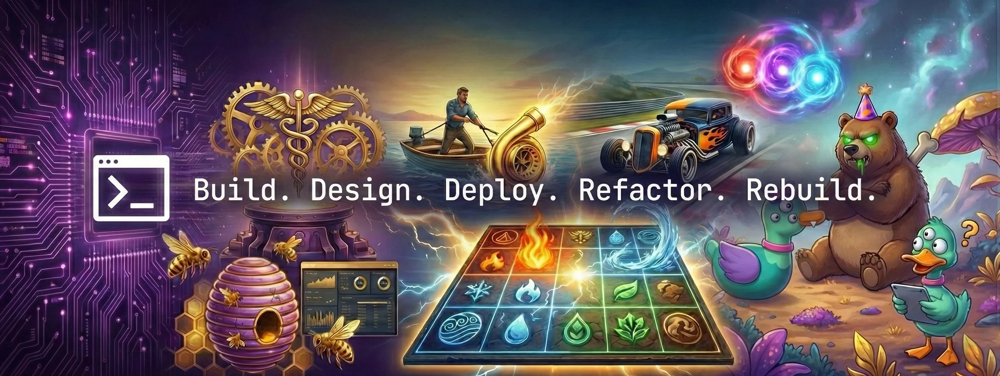

</div>

## 🎯 About Me (`sys_info`)

```yaml
Role: Specialty insurance customer care + contract software developer
Focus: Defect triage, business systems, full-stack apps
Location: Kentwood, MI (remote / hybrid)
Mission: Find where the process breaks -> verify it -> build the fix
Portfolio: https://zfyant.space
```

<div align="center">

## 🛠️ Technical Arsenal

### Languages & Frameworks


### Data & Platforms


</div>

---

## 🧭 How I work

I treat bugs the way I treat insurance issues: list the competing explanations, check the evidence, fix the cause, then verify. Recent examples: a missing admin-role check on one of my own API routes (found in a security review, then remediated), and a silent chat failure traced to Firestore security rules.

**Proof:** [ChartForge public preview](https://zfyant.github.io/chart-forge-preview) · [Portfolio](https://zfyant.space)

---

## 🚀 Featured Projects

### 🏥 [ChartForge](https://zfyant.github.io/chart-forge-preview)
#### **Patient-scoped health record workspace** 🔹 *In Development · [Public preview](https://zfyant.github.io/chart-forge-preview) (sample data only)*

**My role:** Designed and built the app end to end, including the review-gated AI write path and patient-scoped access.

Patients and advocates keep their records in one place, ask questions against the chart, and see trends. The AI can propose chart edits but never writes them: every change lands in a review queue and is applied only after a person approves it.

<div align="center">
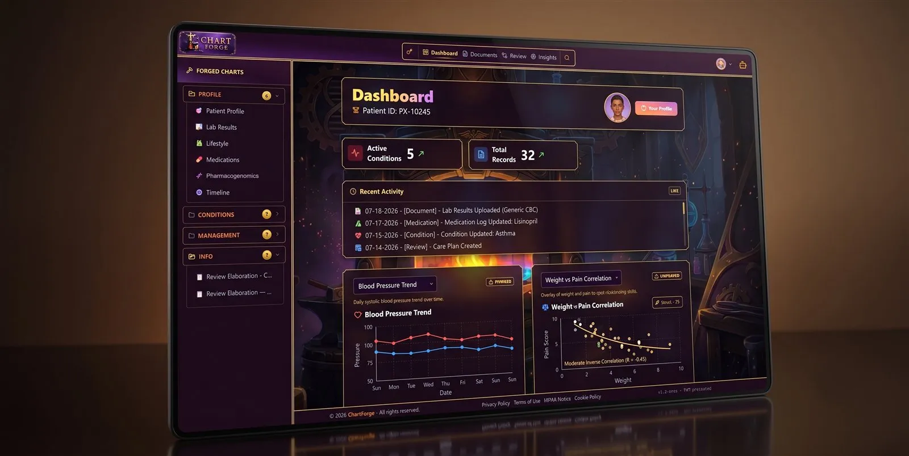
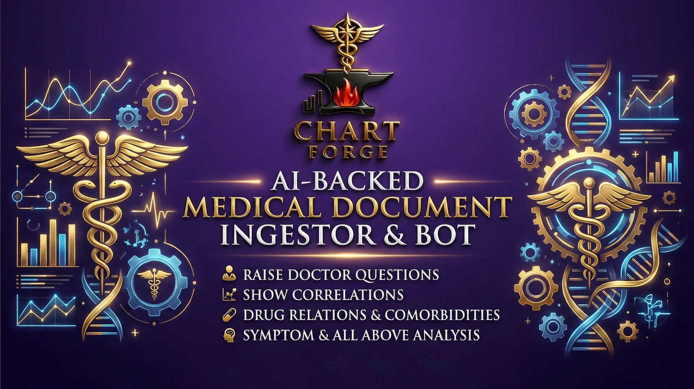
</div>

> **Key features**
> - Patient-scoped access with role checks and Postgres row-level security
> - Chart-aware AI chat with a diff-and-approve review queue
> - Insights scans that flag stale items, conflicts, and gaps
> - Medication and pharmacogenomics views, vitals and symptom trend charts
>
> **Tech stack:** Next.js 16, React 19, TypeScript, Tailwind CSS 4, Supabase, Vercel AI SDK (OpenRouter), Zustand, Zod, Recharts, Vitest

---

### 💎 Gold & Diamond Zone
#### **Multi-storefront retail platform and inventory system** 🔹 *Client contract · Private repo*

**My role:** Sole developer on the platform, then one additional worker and I enter inventory on the side. The owner pays us weekly.

A jewelry and bullion retailer hired me to replace its website. The work grew into two storefronts, a shared admin app, a legacy WooCommerce to Firestore catalog migration, and inventory workflows that I validate against the physical store each week. Automated metal-price formulas are still in development.

<div align="center">

</div>

> **Key features**
> - Shared Firestore inventory with per-storefront visibility
> - Catalog migration with data cleanup and duplicate removal
> - Archive-with-restore instead of hard delete
> - Metal-specific fields and configurable bulk repricing
>
> **Tech stack:** React, Vite, TypeScript, Firebase (Auth, Firestore, Storage), npm workspaces, Turborepo

---

### 🥚 Chikling
#### **Discord game platform with website and worker** 🔹 *Private repo · Active*

**My role:** Designed and built the modular monolith and the production VPS deploy.

Private Discord village and companion website sharing one game core. Bot, web, and worker run as process roles over a shared TypeScript package, with Postgres and Docker Compose locally and Ubuntu + Caddy in production. Restart scripts include a Vitest gate before the web rebuild.

> **Key features**
> - Shared game core across Discord and website
> - Postgres-backed Docker Compose for local work
> - Production Docker Compose and Caddy reverse proxy on a VPS
> - Lifecycle scripts for start, restart, shutdown, and LAN phone testing
>
> **Tech stack:** TypeScript, Node 22, PostgreSQL, Docker Compose, Vitest, Caddy

---

### 👽 MumbulMate
#### **AI companion with persistent memory and progression** 🔹 *Private repo*

**My role:** Built the app and remediated a missing admin-role check found in a security review of my own code. The route now returns 401 and 403 to unauthorized callers.

An AI companion app with memory, character behavior, experience, currency, and an unlockable shop.

<div align="center">
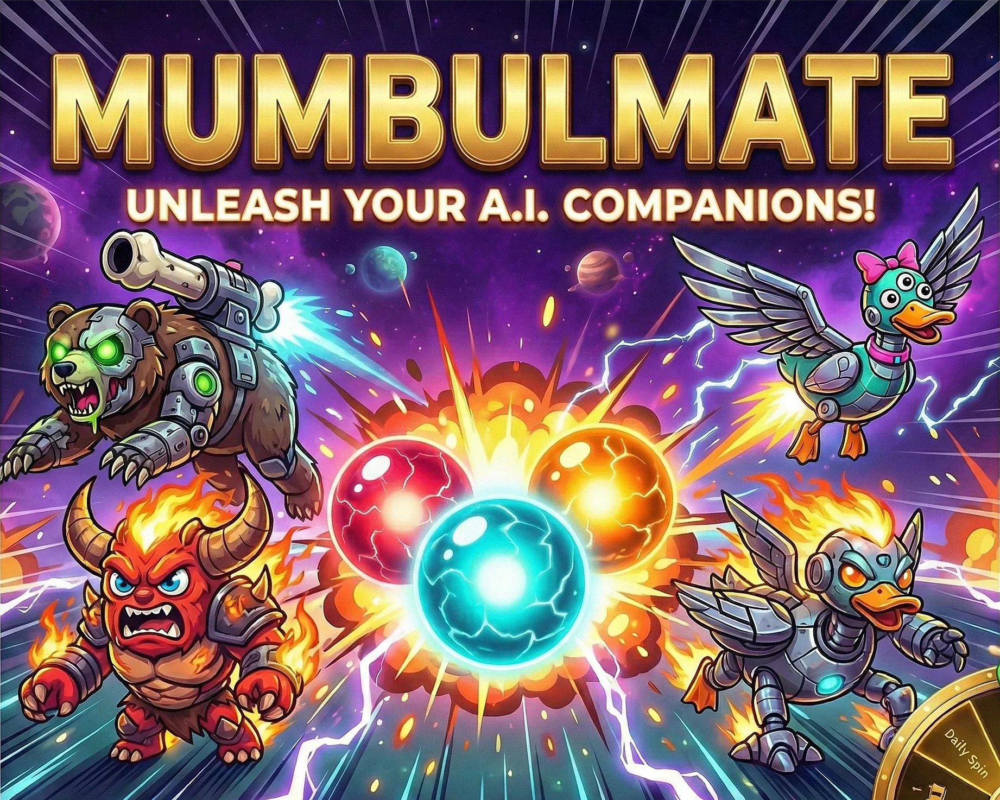
</div>

> **Tech stack:** Next.js, React, TypeScript, Supabase, Zod, Vitest, Playwright

---

### 🧰 Office Reinstaller
#### **Cross-platform Office cleanup and reinstall utility** 🔹 *Private repo · Shipped utility*

**My role:** Built the guided flow and the test suite around it.

Python desktop utility for admins who need to scrub stale Microsoft Office state and reinstall a chosen edition from official Microsoft delivery endpoints. Supports Windows and macOS, Retail and Volume licensing, with structured JSONL logs, readiness checks, and a suite of automated tests covering the orchestrator and related helpers.

> **Tech stack:** Python, Flet, pytest

---

## 🗂️ Earlier projects

| Project | What it is | Stack |
|---|---|---|
| **[Career Finder](https://github.com/Zfyant/career-finder)** ([try it](https://zfyant.github.io/career-finder/)) | Browser-only questionnaire that builds a career profile you can paste into an LLM. No server storage. | HTML, CSS, vanilla JS |
| **[Projectifier](https://github.com/Zfyant/Projectifier)** | Project dashboard for notes, timelines, and progress tracking | Python, Flask, SQLite, JavaScript |
| **[Gamer Finder](https://github.com/Zfyant/gamer-finder)** | Game library organizer with Steam sync CLI, friends, and a discovery dashboard | Flask, SQLAlchemy, SQLite |
| **[1-Click Backup](https://github.com/Zfyant/1-click-backup)** | Versioned 7-Zip backups of any folder | PowerShell |
| **[Line Counter](https://github.com/Zfyant/Line_Counter)** · **[Summarizer](https://github.com/Zfyant/Summarizer)** | Small Python utilities for code size and project structure | Python |

<div align="center">
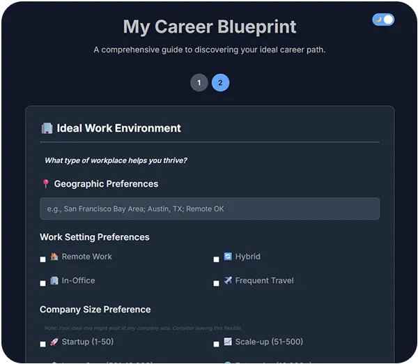
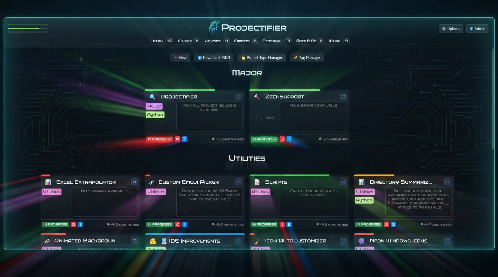
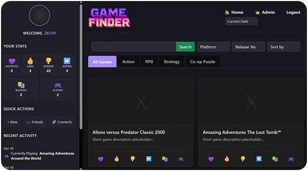
</div>

---

## 🖼️ More from the portfolio

Compact cards for other shipped or in-progress work that already has a thumbnail. Details live on [zfyant.space](https://zfyant.space).

<table>
<tr>
<td width="50%" valign="top" align="center">
<a href="https://github.com/Zfyant/ZechDev">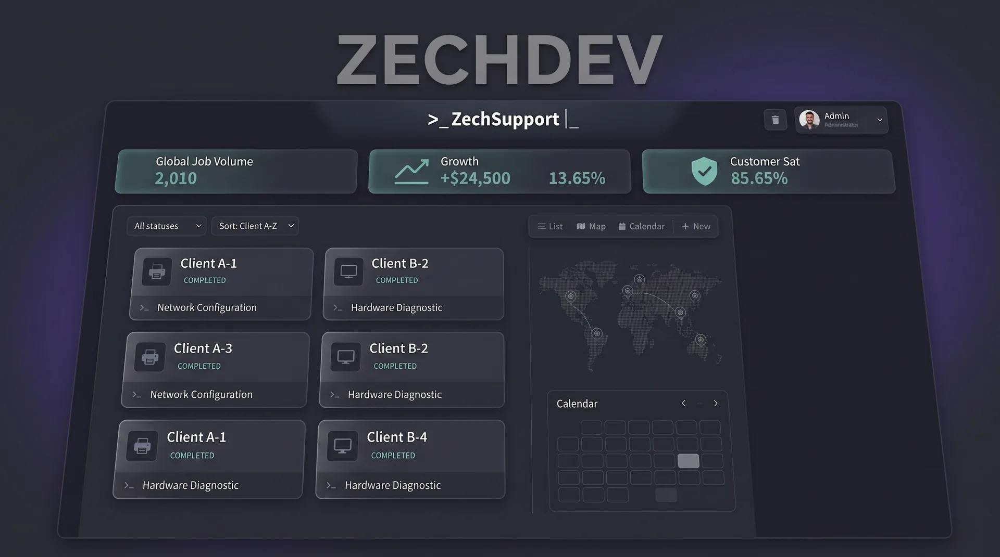</a>
<br /><b>ZechDev</b><br />
<sub>Ops console for field tech-support work: clients, jobs, estimates, staff</sub>
</td>
<td width="50%" valign="top" align="center">
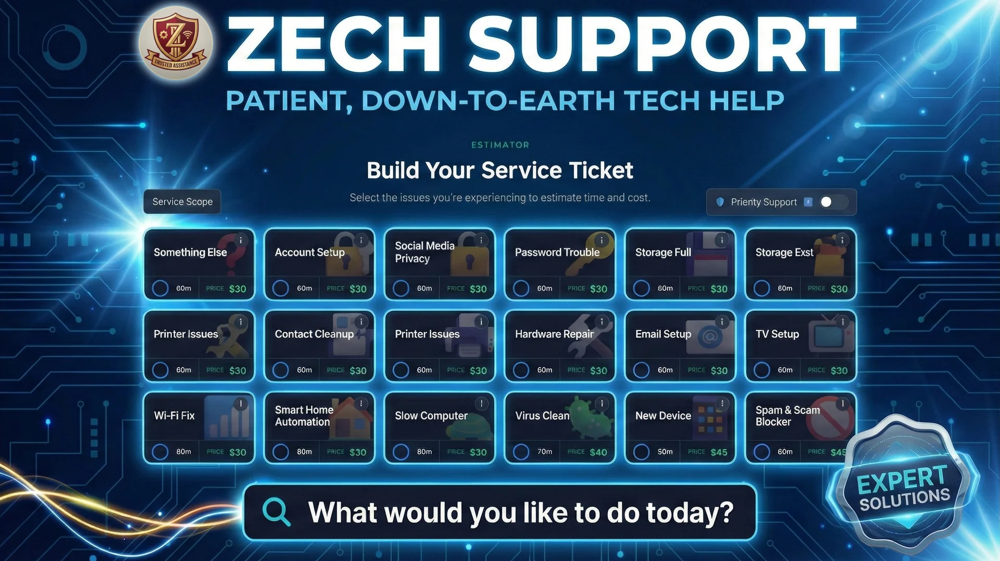
<br /><b>ZechSupport</b><br />
<sub>Client-facing portal and ticket estimator for local tech support</sub>
</td>
</tr>
<tr>
<td width="50%" valign="top" align="center">
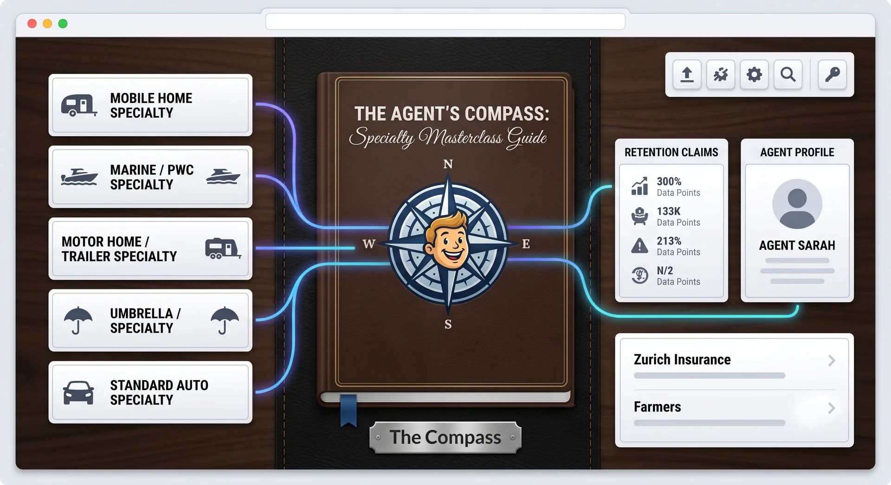
<br /><b>The Compass</b><br />
<sub>Single-file desk reference used on the Farmers / Foremost floor</sub>
</td>
<td width="50%" valign="top" align="center">
<a href="https://github.com/Zfyant/BusyBeeBinz-Inventorizer">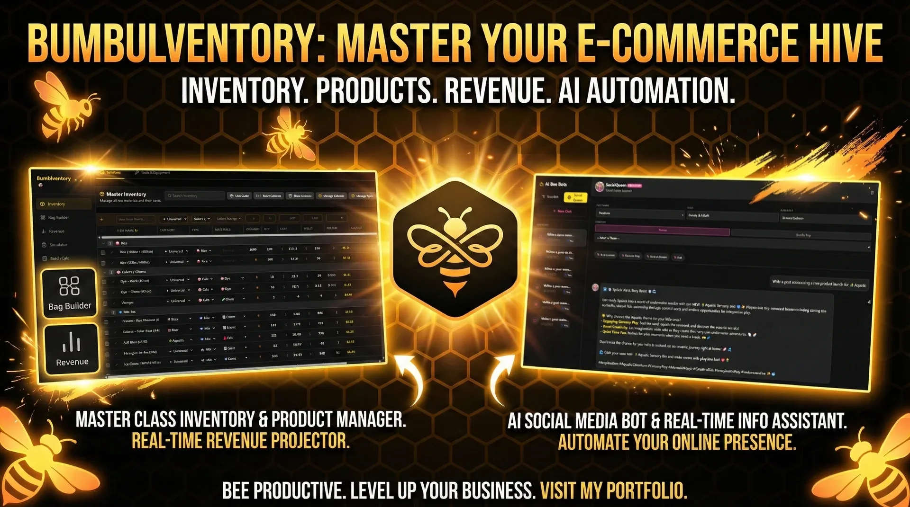</a>
<br /><b>Bumblventory</b><br />
<sub>Inventory, bag recipes, and restock planning for themed gift makers</sub>
</td>
</tr>
<tr>
<td width="50%" valign="top" align="center">
<a href="https://delc.store">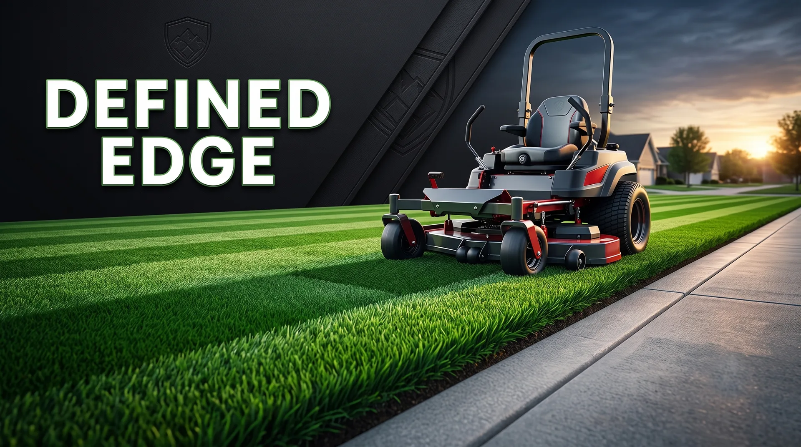</a>
<br /><b>Defined Edge</b><br />
<sub>Lawn-care marketing site with packages, portfolio, and quote flow</sub>
</td>
<td width="50%" valign="top" align="center">
<a href="https://github.com/Zfyant/Elemental-RPS">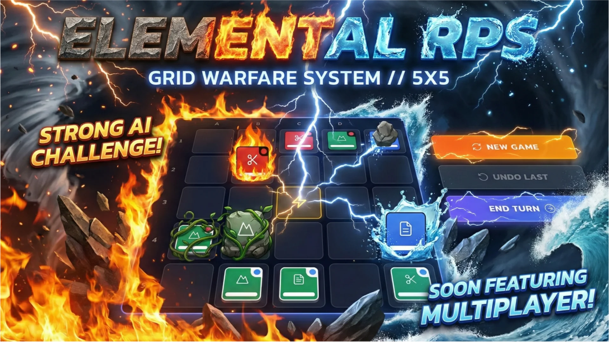</a>
<br /><b>Elemental RPS</b><br />
<sub>Browser tactics game: RPS movement plus Fire / Grass / Water affinities</sub>
</td>
</tr>
</table>

---

## 💼 Experience

> **Customer Service Representative, Grade 30 · Farmers Insurance (Foremost)** · 02/2024 to present
>
> - Investigate customer and agent concerns and decide whether the cause is a system defect, a procedure, user input, an access limit, or a training gap
> - Took part in cloud phone system user acceptance testing and recorded the results for the technical team
> - Built Compass, a single-file desk reference, and shared it with peers
> - Train new peers and take on difficult service requests
>
> **Contract Software Developer (1099) · Gold & Diamond Zone** · 02/2026 to present
>
> **Operator, Output Management Services · Farmers Insurance** · 09/2021 to 02/2024

---

## 🎯 Now

- **Current focus:** Hardening ChartForge's review flows and reference-grounded answers
- **At work:** Studying for the Michigan P&C producer license
- **Looking for:** Remote or hybrid defect analyst, business systems, or developer roles

---

## 📞 Let's Connect

<div align="center">

[Portfolio: zfyant.space](https://zfyant.space)

</div>
